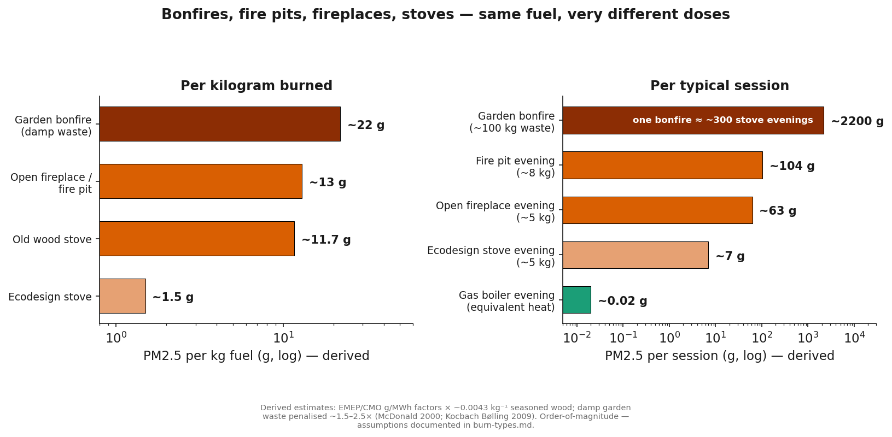

# Not all burning is equal: open fires, stoves, fire pits and bonfires

Different devices emit at different rates, put the smoke in different
places, and expose different people. The short version:

- **Per kilogram of fuel**, open burning (bonfires, fire pits, open
  fireplaces) is the dirtiest — open combustion can't control airflow,
  so it smoulders.
- **Per typical session**, the garden bonfire dwarfs everything —
  it burns tens of kilograms of often-damp waste in one evening.
- **Per year of exposure**, the humble wood stove is the insidious one —
  moderate emissions, every single evening, all winter, for decades.

---

## The comparison table

| | Open fireplace | Closed wood stove | Fire pit / chiminea | Garden bonfire |
|---|---|---|---|---|
| **Combustion control** | Poor — open hearth | Best of the four (still poor vs boilers) | Poor — open bowl | Worst — uncontrolled, often damp fuel |
| **PM2.5 per kg fuel** *(derived — see notes)* | ~13 g | ~1.5 g (Ecodesign) – ~12 g (old stove) | ~13 g+ (open burning) | ~13–30 g+ (damp garden waste smoulders) |
| **Typical session fuel** | ~5 kg | ~5 kg | ~8 kg | 50–150+ kg |
| **PM2.5 per session** *(derived)* | ~60 g | ~7–60 g | ~100 g+ | **~1–4 kg** |
| **Smoke released at** | Chimney + room spills | Chimney (rooftop) + room at refuelling | **Seated head height** | Ground level, whole street |
| **Who is exposed** | Household + neighbours | Household + neighbours, chronically | Everyone sitting round it + neighbours | The whole street, intensely, for hours |
| **Extra hazards** | Heat mostly lost up the flue | Lab rating overstates real-world performance | Drifting smoke follows the people; embers | Treated/painted wood, plastics → dioxins, heavy metals; statutory nuisance |

*Derived numbers: see "how the numbers were derived" below — treat as
order-of-magnitude estimates, not precise inventories.*

---

## Open fireplace (indoor)

The worst emitter per unit of useful heat in the official tables —
**2,950 g PM2.5/MWh**, ~4,100× a gas boiler (UK CMO 2022 / EMEP 2019).
Open fires can't regulate airflow: fuel smoulders when not flaming, and
most of the heat goes up the chimney anyway (typical efficiency ~15–25%).
The room takes a double dose: chimney emissions outside plus direct
spillage indoors.

**Citations:** CMO/EMEP 2019 · McDonald 2000 · Kocbach Bølling 2009

## Closed wood stove

Controlling the air supply makes stoves *better than open fires* —
and still hundreds of times dirtier than any non-combustion heating
(Ecodesign 335 g/MWh ≈ ~450× gas; older stoves 2,660 g/MWh). The stove's
signature is **chronic, low-level, community-wide exposure**: chimney
emissions every evening all winter, plus indoor PM2.5 flooding at every
refuelling (Chakraborty 2020). Its harm comes from *persistence*, not
single-event intensity.

**Citations:** CMO/EMEP 2019 · AQEG 2017 · Chakraborty 2020

## Fire pit / chiminea (outdoor)

A fire pit is an **open fireplace with no chimney** — the combustion is
the same uncontrolled smoulder-and-flame, but the smoke is released at
seated head height rather than rooftop height. Everyone around the fire
breathes it directly (the smoke visibly tracks people as wind shifts);
the rest drifts into neighbouring gardens and windows. Fire pits also
burn on the worst possible schedule — leisure evenings and weekends,
when the neighbours are outside too.

**Citations:** Lemieux 2004 (open burning > controlled combustion per kg
fuel) · Andreae 2019 (biomass burning EFs) · Naeher 2007

## Garden bonfire

The biggest single-event source a resident can create. Bonfires:

- burn **tens to hundreds of kilograms** in one event;
- usually burn **damp garden waste** — high moisture means smouldering,
  the combustion mode with the highest PM and CO emissions per kg
  (Kocbach Bølling 2009);
- frequently include **treated/painted timber, fence panels, plastics
  and household waste** — adding dioxins/furans, heavy metals and
  chemical toxins to the smoke (Lemieux 2004; Andreae 2019 lists
  domestic waste burning as a distinct high-toxicity category);
- are the one burn type that can constitute a **statutory nuisance**
  under UK law (Environmental Protection Act 1990) — councils can and
  do act on bonfire smoke even though bonfires aren't illegal per se.

Bonfire-night air quality is measurable at city scale: on Guy Fawkes
night, London's particulate *oxidative burden* — the particles' capacity
to deplete lung antioxidants — rises sharply, and the pyrotechnic-
related fraction is more toxic per microgram than traffic PM
(Godri et al. 2010).

**Citations:** Lemieux 2004 · Andreae 2019 · Kocbach Bølling 2009 ·
Godri 2010 · EPA 1990 (statutory nuisance)

---

## How the numbers were derived (honesty box)

| Assumption | Value | Basis |
|---|---|---|
| Wood lower heating value | ~15.5 MJ/kg → ~0.0043 MWh/kg | standard value for seasoned logs |
| PM2.5 per kg | EF[g/MWh] × 0.0043 | derived from CMO/EMEP factors |
| Session fuel loads | fire 5 kg, pit 8 kg, bonfire 50–150 kg | typical reported loads |
| Damp garden waste penalty | ~1.5–2.5× open-fire EF | moisture effect per McDonald 2000 / Kocbach Bølling 2009 |

So a single **150 kg garden bonfire ≈ 1.5–4 kg of PM2.5** — roughly the
PM2.5 of **200–500 evenings of an Ecodesign stove**, released into one
street in one afternoon.

---

## Bottom line

- **Bonfires and fire pits** win on intensity: uncontrolled combustion,
  worst-per-kg emissions, smoke delivered at breathing height to
  everyone nearby.
- **Wood stoves** win on dose: smaller hourly emissions but relentless —
  every evening, all winter, every year, for the whole street.
- **Open fireplaces** are the worst of both: near-bonfire emission rates
  *plus* direct indoor spillage.
- The only "clean" version of any of them is not burning. If you must
  burn outdoors, dry untreated wood, small loads, hot flames — and
  remember the smoke is the neighbours' problem too, literally.

**Try it yourself:** the [wood smoke calculator](calculator.html) lets you
plug in your appliance, fuel load and burning pattern and see the grams —
plus what they mean as car-km and pools of air at the WHO limit.
