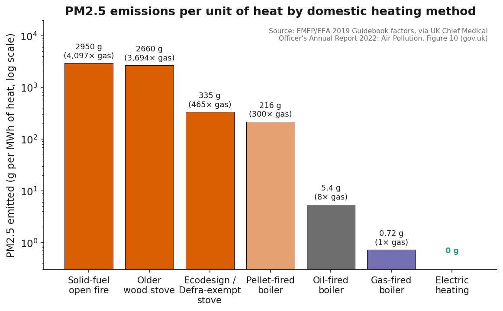
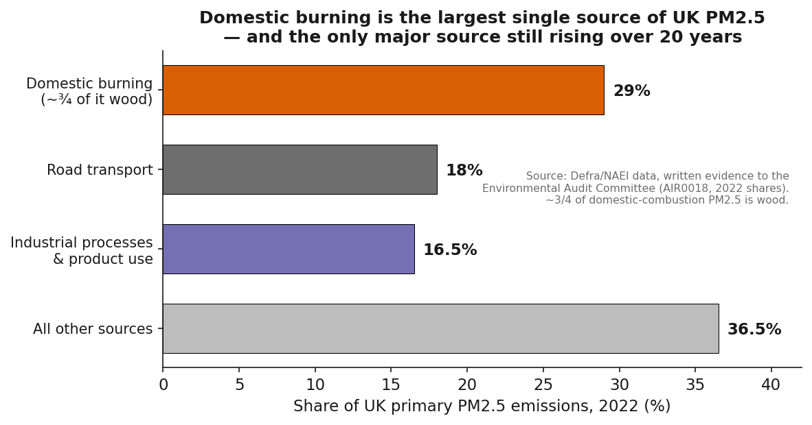
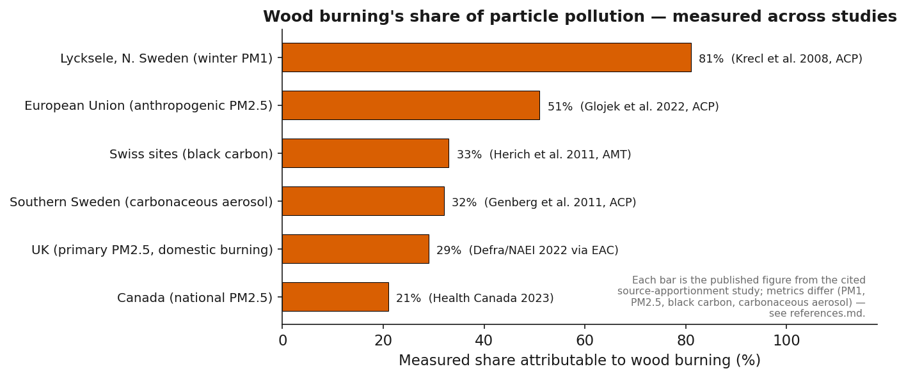
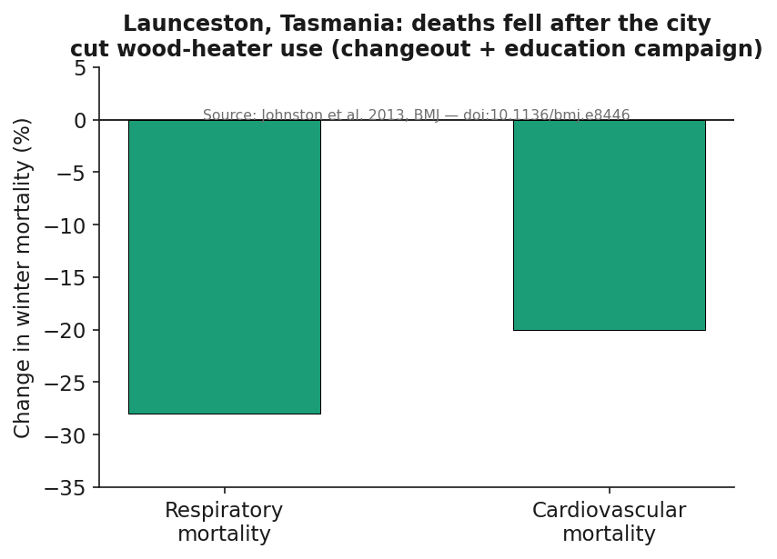
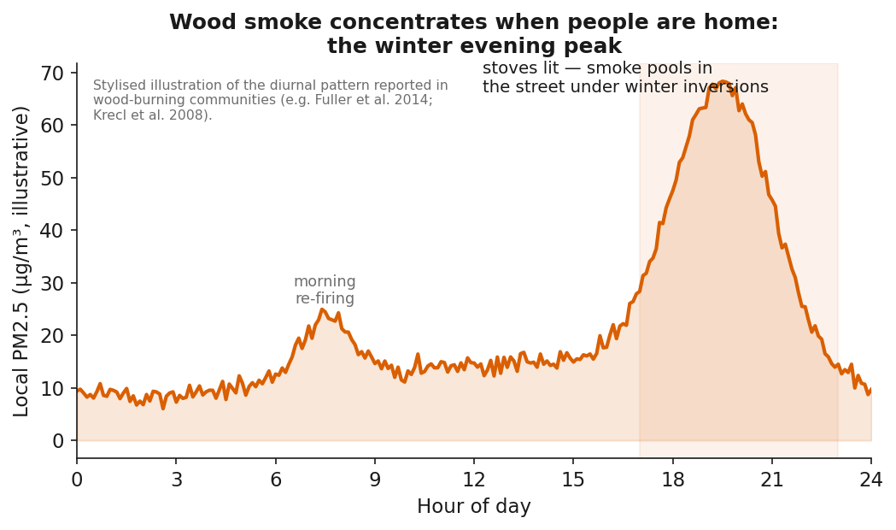
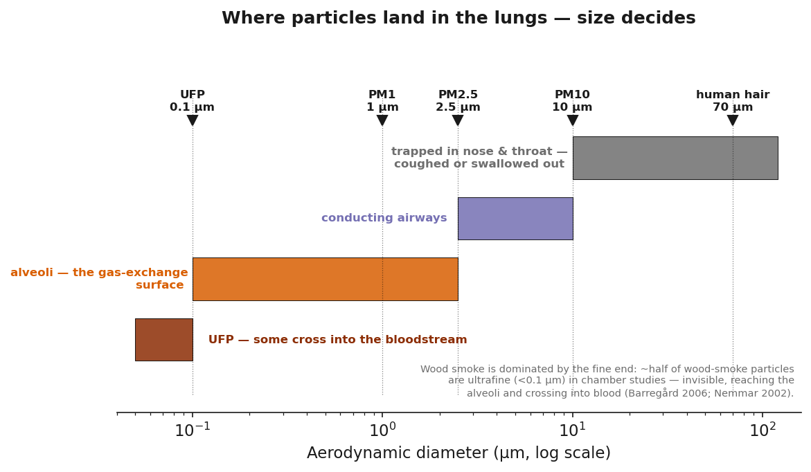
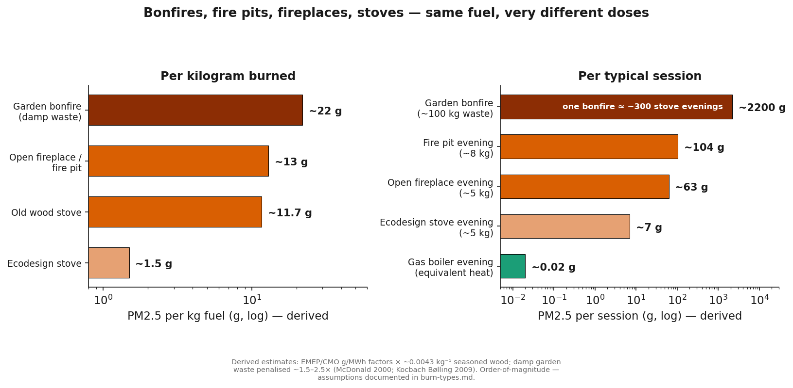

# Wood smoke from domestic burning — the evidence

**TL;DR:** Residential wood burning is the single largest source of primary
PM2.5 in the UK and the EU, and a leading source in North America. Wood smoke
contains the same classes of toxins as tobacco smoke — fine particles,
PAHs, benzene, formaldehyde, dioxins — and there is no known safe level of
PM2.5. Even a modern "Ecodesign" stove emits roughly **450 times** more PM2.5
per unit of heat than a gas boiler, and real-world use is far dirtier than
laboratory ratings suggest. The smoke does not stay in your chimney: it
builds hyper-local hotspots and infiltrates neighbouring homes through
closed windows. When communities have switched away from wood heating,
**mortality measurably fell**.

## Headline numbers

| Figure | Value | Source |
|---|---|---|
| Domestic burning share of UK primary PM2.5 (2022) | **29%** — largest single source; only source still rising over 20 yr | Defra/NAEI via [Environmental Audit Cttee evidence](https://committees.parliament.uk/writtenevidence/163116/html/) |
| Wood burning share of EU anthropogenic PM2.5 | **~51%** — largest source | [Glojek et al. 2022](https://doi.org/10.5194/acp-22-5577-2022) |
| Wood smoke share of Canada PM2.5 | **21%** vs ~12% all road transport | [Health Canada 2023](https://publications.gc.ca/site/eng/9.917507/publication.html) |
| Ecodesign stove vs gas boiler (PM2.5 per MWh) | **~450×** (335 vs 0.72 g/MWh) | [UK CMO Annual Report 2022, Fig. 10](https://www.gov.uk/government/publications/chief-medical-officers-annual-report-2022-air-pollution) |
| Older conventional stove vs gas boiler | **~3,700×** (2,660 vs 0.72 g/MWh) | same |
| Winter PM1 from residential wood burning, Lycksele (Sweden) | **up to 81%** | [Krecl et al. 2008](https://doi.org/10.5194/acp-8-3639-2008) |
| Deaths attributable to household air pollution, globally | **~3.2 million/yr** | [WHO](https://www.who.int/news-room/fact-sheets/detail/household-air-pollution-and-health) |
| Mortality fall after Launceston cut wood-heater use | **−28% respiratory, −20% cardiovascular** | [Johnston et al. 2013, BMJ](https://doi.org/10.1136/bmj.e8446) |
| UK wood-burner households with no alternative heating | **~8%** (4% rely solely on solid fuel) | [BEIS/Kantar "Burning in UK Homes" 2020](https://naei.energysecurity.gov.uk/reports/burning-uk-homes-and-gardens-plus-number-annexes); [Global Action Plan FAQ](https://www.actionforcleanair.org.uk/evidence-resources/domestic-burning-faqs) |
| Premature deaths from PM2.5, globally (2015) | **~8.9 million** — harm continues below legal standards | [Burnett et al. 2018, PNAS](https://doi.org/10.1073/pnas.1803222115) |

## Documents

### The evidence base
- [Master evidence review](evidence.md) — what wood smoke is, where it goes,
  how it harms, and what happens when communities stop burning.
- [What wood smoke does inside your body](the-body.md) — the mechanism
  walk-through: deposition → airway inflammation → bloodstream → heart.
- [Bonfires vs fire pits vs wood stoves vs open fires](burn-types.md) —
  same fuel, very different doses; how each burn type puts its smoke
  in a different place.
- [Full bibliography](references.md) — every source, DOI-linked.
- [Campaign groups & official resources](advocacy.md) — Doctors & Scientists
  Against Wood Smoke Pollution, Mums for Lungs, Clean Air Hub, and more.

### The rebuttals — claim by claim
[Full index](arguments/index.md):

1. ["Wood is renewable, so it's carbon neutral"](arguments/carbon-neutral.md)
2. ["It's natural — humans have always burned wood"](arguments/natural-safe.md)
3. ["Modern eco-stoves are clean"](arguments/modern-stoves-clean.md)
4. ["Traffic and industry are far bigger problems"](arguments/traffic-worse.md)
5. ["It's my home — my stove only affects me"](arguments/only-affects-me.md)
6. ["It's within legal limits, so it's safe"](arguments/within-limits-safe.md)
7. ["Banning wood burning hurts people who can't afford alternatives"](arguments/fuel-poverty.md)
8. ["I burn dry, seasoned wood correctly — so mine is fine"](arguments/dry-wood-proper-use.md)

### Presentation
- [Slides (HTML)](slides.html) | [Slides source](slides.md)

### Figures
Generated by [`scripts/make_woodsmoke_figures.py`](../../scripts/make_woodsmoke_figures.py):

**Animations & interactive:**

- [Particle journey through the body (GIF)](figures/anim_body_pathway.gif) —
  nose → airways → alveoli → bloodstream → heart
- [Burn-type plume comparison (GIF)](figures/anim_burn_types.gif) —
  chimney vs head-height vs whole-street smoke
- [Neighbourhood smoke dispersion (GIF)](figures/anim_dispersion.gif) —
  the plume doesn't stop at the fence
- [Stove-door refuelling spikes (GIF)](figures/anim_refuel_spike.gif) —
  indoor PM2.5 flooding, after Chakraborty et al. 2020
- [Interactive chart: study-by-study shares (HTML)](figures/interactive_sources.html)
