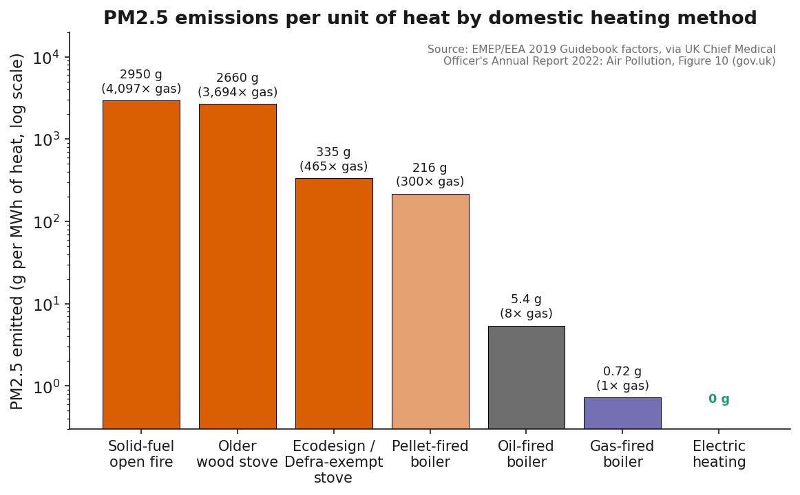
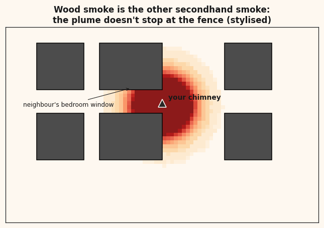
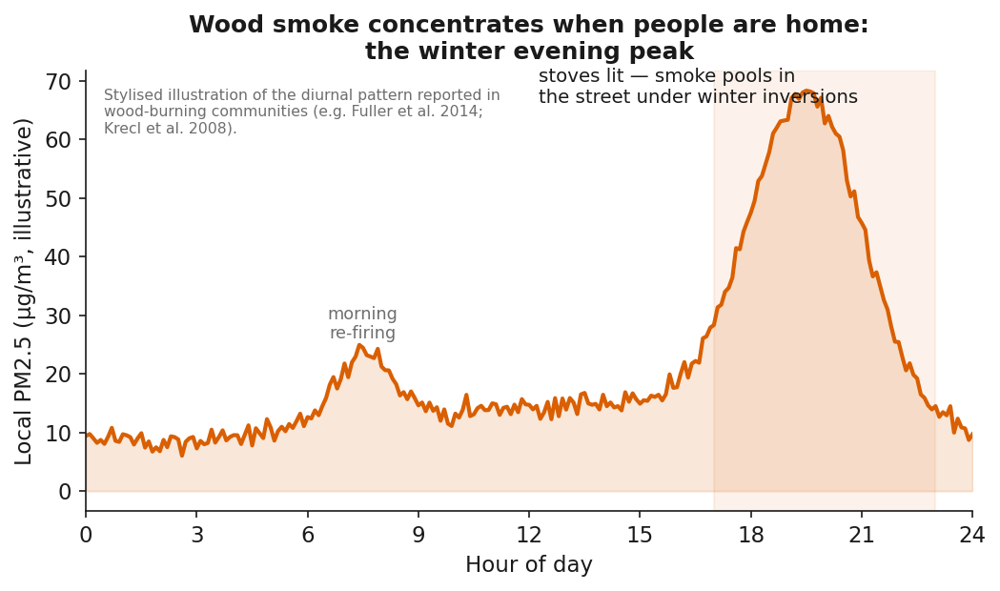
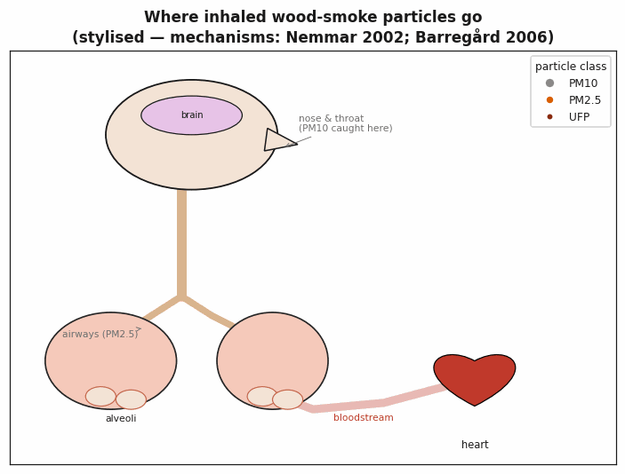
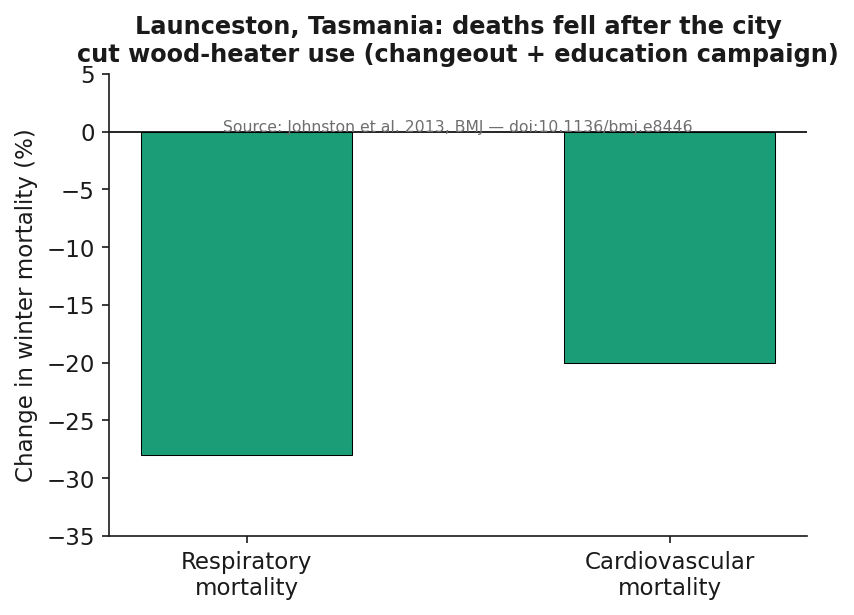
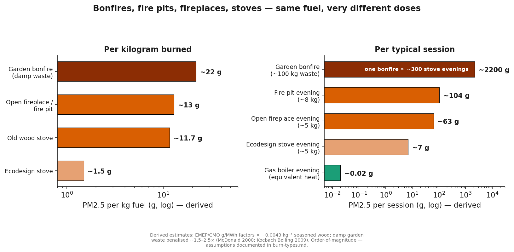

# Wood smoke: the evidence
### Residential wood burning — claim by claim, citation by citation

*Every number on these slides is sourced. Full bibliography in `references.md`.*

---

# The headline

> **Domestic wood burning is the largest single source of primary PM2.5 in the UK — 29% in 2022 — and the only major source still rising.**

- Road transport: 18%. Industrial processes: 16.5%.
- EU: ~51% of anthropogenic PM2.5 is wood burning — the largest source.
- Canada: wood smoke ≈ 21% of PM2.5 — more than all transport (~12%).
- ERS position paper: **≥40,000 premature deaths/yr in Europe** from biomass smoke.

Defra/NAEI via Environmental Audit Cttee (AIR0018); Glojek et al. 2022, ACP; Health Canada 2023; Sigsgaard et al. 2015, ERJ

---

# What's in wood smoke

The same classes of toxins as tobacco smoke (Naeher et al. 2007):

- **PM2.5 / PM1 / ultrafines** — reach the bloodstream
- **PAHs** (incl. benzo[a]pyrene), **benzene**, **formaldehyde**
- **Dioxins & furans**, **carbon monoxide**, **black & brown carbon**
- IARC: indoor biomass smoke = **Group 2A, probably carcinogenic**

Naeher et al. 2007, Inhal. Toxicol.; Schauer et al. 2001, ES&T; IARC Monographs Vol. 95 (2010)

---

# "But my stove is eco" — the government's own numbers

**Ecodesign stove: ~450× the PM2.5 of gas per unit of heat.**
Older stove: ~3,700×. Even a pellet boiler: ~300×.

One Ecodesign stove ≈ **up to 6× a Euro-6 HGV** (AQEG).

EMEP 2019 factors via UK CMO Annual Report 2022, Fig. 10; AQEG Biomass 2017

---

# Lab ratings ≠ your living room

- Real-world emissions swing **many-fold** with moisture, species, operation (McDonald 2000)
- Every door-opening **floods the room with PM2.5** — 'eco' stoves included (Chakraborty 2020)
- Slumbered overnight burns = the most toxic mode (Kocbach Bølling 2009)

McDonald et al. 2000 ES&T; Chakraborty et al. 2020 Atmosphere; Kocbach Bølling et al. 2009 PFT

---

# It doesn't stay in your chimney

- Infiltrates neighbouring homes **through closed windows**
- Neighbours can see **~100×** regional monitor levels — hotspots no regulator measures
- "The other secondhand smoke" (DSAWSP)

Su et al. 2011; Chafe et al. 2014 EHP; dsawsp.org

---

# It peaks exactly when people are home

Cold, still winter evenings: inversions trap smoke at breathing height in residential streets. Alpine schools have kept children **indoors** because of it.

Fuller et al. 2014; Krecl et al. 2008; BBC 2017

---

# Where inhaled particles go

- Ultrafine particles reach the **bloodstream within 1 minute** (Nemmar 2002)
- Chamber studies: **neutrophilic lung inflammation in 2 h** (Ghio 2012), oxidative stress (Olin 2008)
- **Stiffer arteries + blunted heart-rate variability within an hour** (Unosson 2013)
- Mechanism → heart attacks, strokes, arrhythmias (AHA: Brook 2010)

Nemmar 2002 Circulation; Ghio 2012 OEM; Unosson 2013 PFT; Brook 2010 Circulation

---

# There is no safe level of PM2.5

- **WHO 2021:** no evidence of a threshold below which no harm occurs (guideline: 5 µg/m³ annual)
- Harm continues **below legal limits** — 8.9M deaths globally in 2015 (Burnett 2018, PNAS)
- ~3.2M deaths/yr from household air pollution (WHO)
- UK CMO: air pollution is the **largest environmental threat to health**

WHO AQG 2021; Burnett et al. 2018; WHO fact sheet; UK CMO 2022

---

# The proof: when communities burn less, fewer die

**Launceston, Tasmania** — wood-heater changeout + education:

- Respiratory mortality **−28%**
- Cardiovascular mortality **−20%**

Johnston et al. 2013, BMJ — doi:10.1136/bmj.e8446

---

# Bonfires vs stoves vs fire pits — same fuel, different dose

- **Open burning is the dirtiest per kg** (Lemieux 2004, EPA)
- **One garden bonfire ≈ ~300 stove evenings** of PM2.5 (derived)
- **Fire pits** release at seated head height — straight into guests' and neighbours' lungs
- **Stoves** win on chronic dose: every evening, all winter, every year

EMEP/CMO 2022 factors (derived); Lemieux 2004 PECS; Andreae 2019 ACP; Kocbach Bølling 2009

---

# The climate myth

"Carbon neutral" is accounting over decades — not reality today:

- Wood emits **more CO₂ per unit energy up front than coal**; the carbon debt takes decades to repay (Sterman 2018)
- Black carbon: **2nd most important** human warming agent; accelerates Arctic melt (Bond 2013)
- Brown carbon absorbs sunlight too (Mohr 2013)
- Counting SLCPs: wood stoves = **least** climate-friendly heating (Savolahti 2019)

Sterman et al. 2018 ERL; Bond et al. 2013 JGR; Mohr et al. 2013 ES&T; Savolahti et al. 2019 Energy Policy

---

# "What about people who need it?"

- Only **4%** of UK indoor burners rely on solid fuel for *all* heating; only **~8%** have no alternative
- Most burners live in **towns and cities** and skew **affluent**
- The dependent minority deserve **subsidised switching** — proven by Libby, MT and Launceston changeouts
- The health bill falls on neighbours and the NHS regardless

BEIS/Kantar Burning in UK Homes 2020; Global Action Plan; Noonan et al. 2012; Borchers-Arriagada et al. 2020

---

# The eight claims, answered

| Claim | Reality |
|---|---|
| "Carbon neutral" | More CO₂ than coal up front + black/brown carbon |
| "It's natural" | Same toxin classes as tobacco smoke; IARC 2A |
| "Eco stoves are clean" | ~450× gas boiler PM2.5 — the CMO's own figure |
| "Traffic is worse" | Largest UK/EU PM2.5 source; only one still rising |
| "My home, my choice" | The plume enters the neighbour's bedroom |
| "Within legal limits" | No safe level exists (WHO) |
| "Bans hurt the poor" | ~92% of burners have alternatives |
| "I burn dry wood well" | Harm reduction ≠ harmless — floor is 300–450× gas |

---

# Where to go next

- **Evidence + rebuttals:** this repository (`topics/woodsmoke/`)
- **Doctors & Scientists Against Wood Smoke Pollution** — dsawsp.org
- **Mums for Lungs** — mumsforlungs.org
- **Global Action Plan / Clean Air Hub** — cleanairhub.org.uk
- **EPA Burn Wise** — epa.gov/burnwise

*Lead with the science; use advocacy groups as "where to act".*

Full bibliography: topics/woodsmoke/references.md
