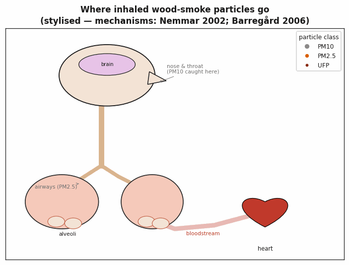
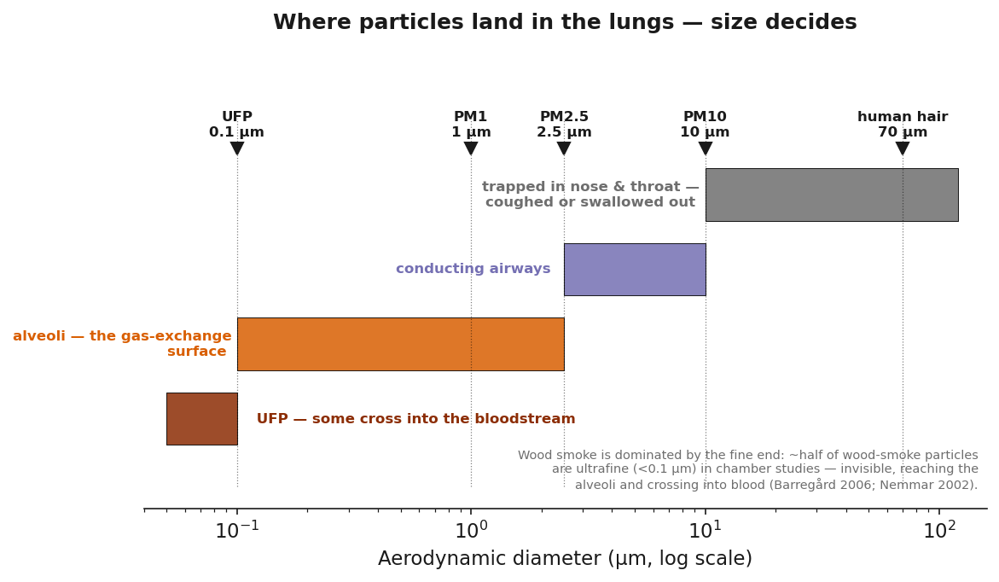

# What wood smoke does inside your body

A guided tour, nose to heart — each step is measured, not hypothetical.

---

## Step 1 — Deposition: where particles land

Where an inhaled particle ends up depends on its size:

| Particle | Diameter | Where it deposits |
|---|---|---|
| PM10 | < 10 µm | Nose, throat, upper airways — partly filtered |
| PM2.5 | < 2.5 µm | Conducting airways **and deep lung** |
| PM1 | < 1 µm | Mostly the **alveoli** — the gas-exchange surface |
| UFP | < 0.1 µm | Alveoli — and some cross into the **bloodstream** |

Wood smoke is dominated by the fine and ultrafine end: in one chamber
study roughly **half the particles were ultrafine (<100 nm)**
(Barregård et al. 2006). These are the sizes with the worst health
outcomes — they can't be coughed out effectively and they sit directly
on the blood-gas barrier.

---

## Step 2 — The airway response: inflammation, fast

Controlled human-exposure studies — volunteers breathing diluted wood
smoke in a chamber — show the lung reacts within hours:

- **Neutrophil influx into the lungs.** Healthy volunteers exposed to
  ~485 µg/m³ wood smoke for 2 hours showed neutrophilic inflammation
  in bronchial and bronchoalveolar lavage 20 hours later — plus a
  systemic blood neutrophil rise (Ghio et al. 2012).
- **Oxidative stress in the lower airways.** Alveolar nitric oxide rose
  3 hours post-exposure; malondialdehyde (a lipid-peroxidation marker)
  in exhaled breath was elevated immediately and at 20 hours
  (Olin/Barregård et al. 2008).
- **Airway epithelial permeability changes** at even modest
  concentrations — the start-up phase of a burn is especially potent
  (Stockfelt/Muala et al. 2012).
- **Susceptible people respond harder.** Atopic volunteers showed
  measurable airway and systemic responses after a few hours of
  wood-burning-stove smoke (Riddervold et al. 2012).

**Citations:** Ghio 2012 · Olin et al. 2008 · Stockfelt et al. 2012 ·
Riddervold 2012 · Barregård 2006

---

## Step 3 — Into the bloodstream

This is the part most people don't believe until they see the imaging:

- Inhaled ultrafine (<100 nm) particles were detected in volunteers'
  blood **within 1 minute**, peaking at 10–20 minutes — particle-bound
  radioactivity reaching the liver and beyond (Nemmar et al. 2002).
- Even where the solid core stays behind, the **chemical cargo crosses**:
  soluble organics (PAHs, metals) and the inflammatory signals the
  lung releases — cytokines, oxidised lipids — enter circulation.
- After wood-smoke exposure, blood shows **serum amyloid A** (a
  cardiovascular risk marker), shifts in **factor VIII / von Willebrand
  factor** coagulation balance, and elevated urinary 8-iso-PGF2α
  (systemic lipid peroxidation) (Barregård et al. 2006).

**Citations:** Nemmar 2002 · Barregård 2006

---

## Step 4 — The cardiovascular system takes the hit

The American Heart Association's scientific statement lays out the
mechanism chain: pulmonary inflammation + oxidative stress → autonomic
imbalance, endothelial dysfunction, pro-coagulant state → **heart
attacks, strokes, arrhythmias** (Brook et al. 2010).

Wood smoke specifically:

- **Stiffer arteries within an hour.** Healthy volunteers exposed to
  wood smoke for 3 hours showed increased central arterial stiffness
  (pulse wave velocity, augmentation index) — the arterial "ageing"
  signature (Unosson et al. 2013).
- **Reduced heart-rate variability** — the heart's autonomic control
  blunted one hour after exposure (Unosson et al. 2013).
- Community epidemiology links residential wood-smoke exposure to
  cardiovascular endpoints even below legal limits (Boman et al. 2003;
  Sigsgaard et al. 2015).
- The intervention evidence is the clincher: Launceston's wood-heater
  changeout cut **cardiovascular mortality ~20%** (Johnston et al. 2013).

**Citations:** Brook 2010 · Unosson 2013 · Boman 2003 · Sigsgaard 2015 ·
Johnston 2013

---

## Step 5 — Longer-term: cancer and the vulnerable

- **Genotoxic cargo.** Wood-smoke PM caused oxidative stress and DNA
  damage in human cell lines — at levels matching or exceeding traffic
  particles (Danielsen et al. 2011). PAHs adsorbed on the particles are
  the classic mutagenic mechanism (Schauer et al. 2001).
- **IARC Group 2A.** Indoor emissions from household biomass combustion
  (primarily wood) are classified **probably carcinogenic to humans**
  (IARC Vol. 95, 2010).
- **Children:** the oldest review in this field found 7 of 8 studies in
  children (especially asthmatics) reporting increased respiratory
  symptoms, infections, and reduced lung function — concluding a
  *causal* relationship was supported (Larson & Koenig 1994). Children's
  developing lungs and immune systems are the highest-risk target
  (Zelikoff et al. 2002).
- **Scale:** a conservative estimate attributes **at least 40,000
  premature deaths per year in Europe** to biomass smoke (Sigsgaard
  et al. 2015); WHO attributes ~3.2 million deaths/yr globally to
  household air pollution.

**Citations:** Danielsen 2011 · Schauer 2001 · IARC 2010 ·
Larson & Koenig 1994 · Zelikoff 2002 · Sigsgaard 2015 · WHO

---

## The mechanism, one line each

1. **Deposits** — fine/ultrafine particles reach the alveoli.
2. **Inflames** — neutrophils, alveolar NO, epithelial permeability.
3. **Oxidises** — lipid peroxidation, antioxidant depletion locally and
   systemically.
4. **Enters blood** — ultrafines translocate within minutes; soluble
   cargo and inflammatory signals follow.
5. **Stiffens arteries, unbalances autonomics, activates coagulation** —
   the acute cardiovascular pathway.
6. **Damages DNA** — PAH-driven mutagenicity over chronic exposure.
7. **Kills measurably** — intervention studies show mortality falls
   when exposure stops.

None of this requires smoke you can see — the most dangerous fraction
is invisible.

---

## References (new to this page)

- Ghio, A.J. et al. (2012). "Exposure to wood smoke particles produces
  inflammation in healthy volunteers." *Occup. Environ. Med.* 69:170.
  [doi:10.1136/oem.2011.065276](https://doi.org/10.1136/oem.2011.065276)
- Olin, A.-C. et al. (2008). "Experimental exposure to wood smoke:
  effects on airway inflammation and oxidative stress."
  *Occup. Environ. Med.* 65:319.
  [doi:10.1136/oem.2006.032458](https://doi.org/10.1136/oem.2006.032458)
- Barregård, L. et al. (2006). "Experimental Exposure to Wood-Smoke
  Particles in Healthy Humans: Effects on Markers of Inflammation,
  Coagulation, and Lipid Peroxidation." *Inhal. Toxicol.* 18:845.
  [doi:10.1080/08958370600685798](https://doi.org/10.1080/08958370600685798)
- Stockfelt, L. et al. (2012). "Effects on airways of short-term
  exposure to two kinds of wood smoke in a chamber study of healthy
  humans." *Inhal. Toxicol.* 24:47.
  [doi:10.3109/08958378.2011.633281](https://doi.org/10.3109/08958378.2011.633281)
- Nemmar, A. et al. (2002). "Passage of inhaled particles into the
  blood circulation in humans." *Circulation* 105:411.
  [doi:10.1161/hc0402.104118](https://doi.org/10.1161/hc0402.104118)
- Unosson, J. et al. (2013). "Exposure to wood smoke increases arterial
  stiffness and decreases heart rate variability in humans."
  *Part. Fibre Toxicol.* 10:20.
  [doi:10.1186/1743-8977-10-20](https://doi.org/10.1186/1743-8977-10-20)
- Brook, R.D. et al. (2010). "Particulate Matter Air Pollution and
  Cardiovascular Disease: An Update to the Scientific Statement From the
  American Heart Association." *Circulation* 121:2331.
  [doi:10.1161/CIR.0b013e3181dbece1](https://doi.org/10.1161/CIR.0b013e3181dbece1)
- Sigsgaard, T. et al. (2015). "Health impacts of anthropogenic biomass
  burning in the developed world." *Eur. Respir. J.* 46:1577.
  [doi:10.1183/13993003.01865-2014](https://doi.org/10.1183/13993003.01865-2014)
- Larson, T.V. & Koenig, J.Q. (1994). "Wood Smoke: Emissions and
  Noncancer Respiratory Effects." *Annu. Rev. Public Health* 15:133.
  [doi:10.1146/annurev.pu.15.050194.001025](https://doi.org/10.1146/annurev.pu.15.050194.001025)
- Zelikoff, J.T. et al. (2002). "The Toxicology of Inhaled Woodsmoke."
  *J. Toxicol. Environ. Health B* 5:269.
  [doi:10.1080/10937400290070062](https://doi.org/10.1080/10937400290070062)
